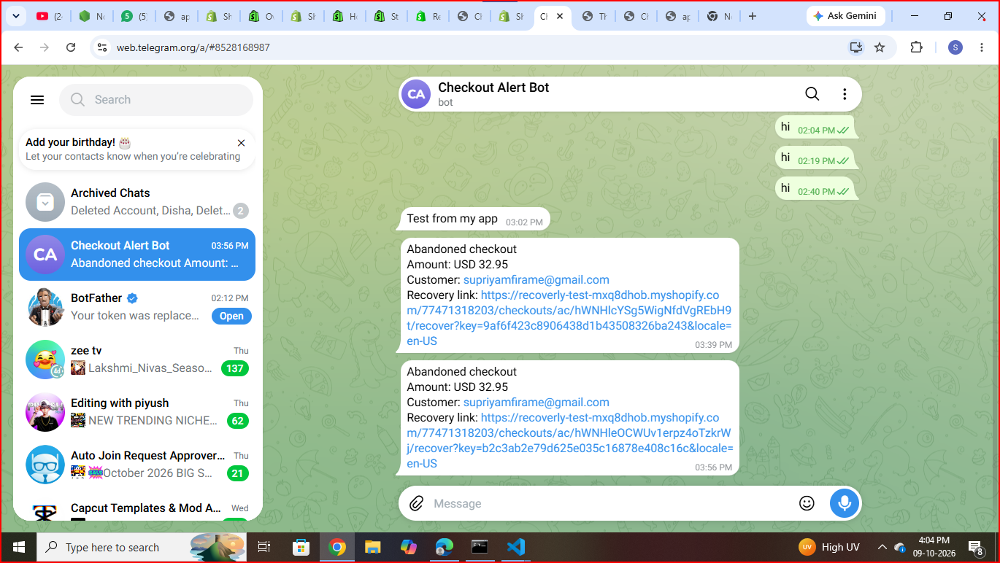
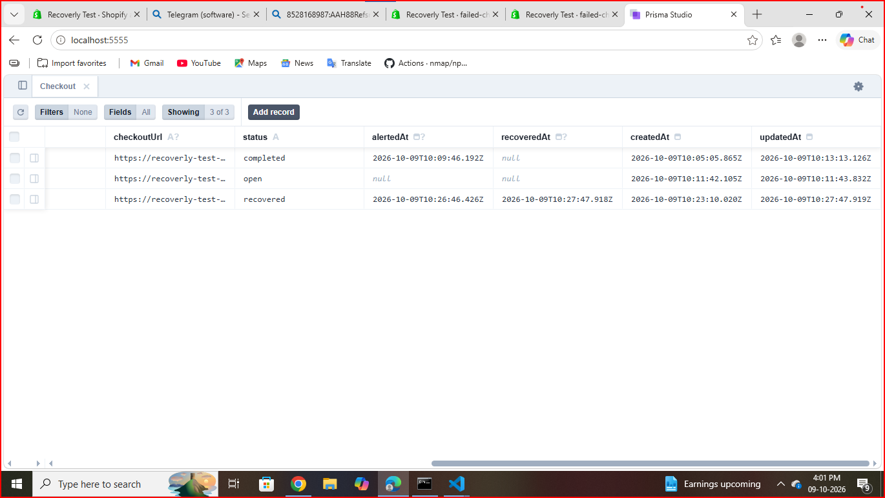

# Failed Checkout Alert (Shopify demo app)

A small Shopify app that listens to webhooks and sends a Telegram alert when a
customer starts checkout but does not complete the order.

## What it does
- Receives `checkouts/update` and `orders/create` webhooks
- Stores each checkout in a database (email, amount, recovery link, status)
- If a checkout is inactive for N minutes, sends a Telegram alert with the recovery link
- If the order is completed after an alert, marks it as "recovered"

## Tech
Node.js, Shopify CLI, React Router app template, Prisma (SQLite), Telegram Bot API

## Setup
1. Install dependencies: `npm install`
2. Create the database: `npx prisma migrate dev`
3. Copy `.env.alerts.example` to `.env.alerts` and fill in your Telegram bot token and chat id
4. Start the app: `npm run dev`
5. In a second terminal start the watcher: `node --env-file=.env.alerts scripts/check-abandoned.mjs`

## Screenshots

**Telegram alert with recovery link**

**Checkout status in the database (open -> alerted -> recovered)**

## Note
Demo project built on a Shopify development store.